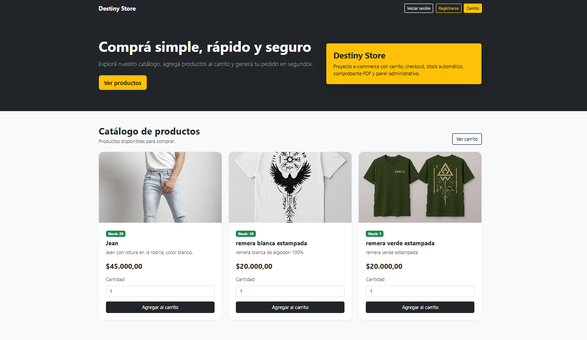
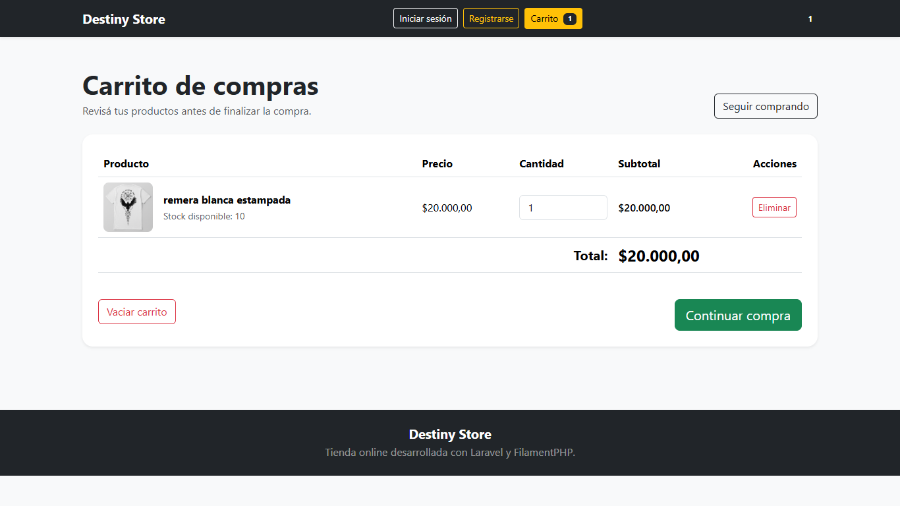
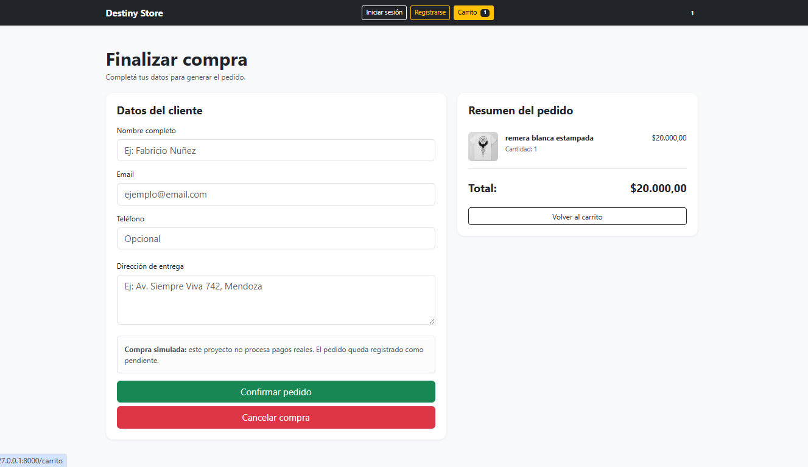
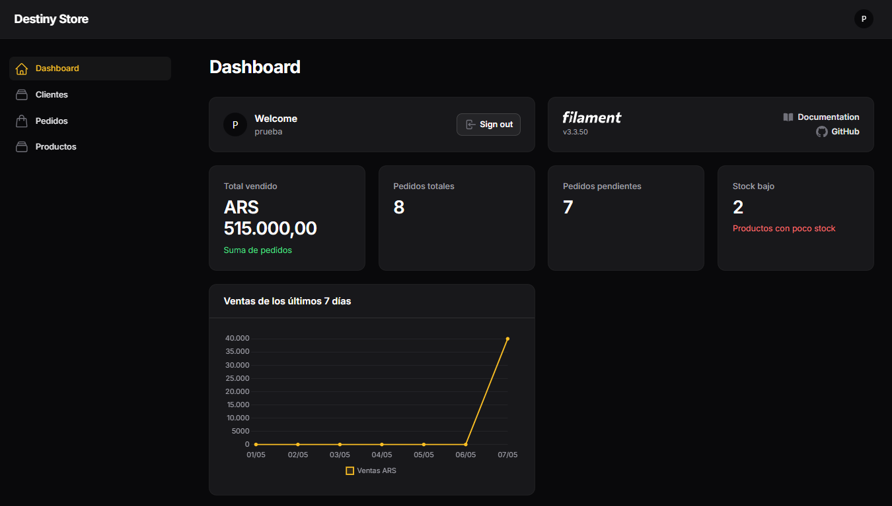
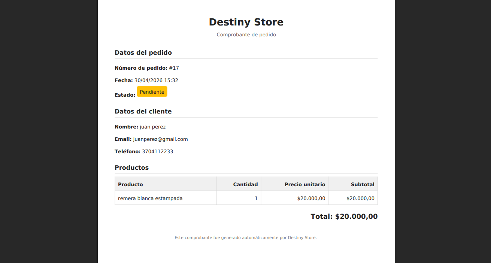

Destiny Store

**E-commerce full stack desarrollado con Laravel 12 y FilamentPHP 3.**

Aplicación web de comercio electrónico que integra catálogo de productos, carrito de compras, gestión de pedidos, pagos con Mercado Pago y panel administrativo.

Desarrollado como proyecto de portafolio, con enfoque en lógica de negocio, integración de APIs y despliegue en la nube.

**[Ver demo online](https://destiny-store.onrender.com)**

> **Demo:** Los pagos utilizan el entorno de pruebas de Mercado Pago. No se realizan cobros reales.

---

Stack tecnológico

| Área | Tecnologías |
|---|---|
| Backend | PHP · Laravel 12 · Eloquent ORM |
| Frontend | Blade · Bootstrap 5 · Tailwind CSS |
| Administración | FilamentPHP 3 |
| Autenticación | Laravel Breeze |
| Base de datos | MySQL · Aiven |
| Integraciones | Mercado Pago · Cloudinary · Resend |
| Infraestructura | Docker · Render · GitHub |
| Documentos | Laravel DomPDF |

Funcionalidades

**Tienda online**
- Catálogo responsive con imágenes, precios y stock.
- Carrito dinámico con actualización de cantidades y totales.
- Checkout con validación de datos y disponibilidad.
- Registro, inicio de sesión y recuperación de contraseña.

**Pagos y pedidos**
- Integración con Mercado Pago Checkout Pro.
- Webhooks con validación de firma y verificación del pago mediante API.
- Gestión de estados: pendiente, pagado, entregado y cancelado.
- Descuento, ajuste y recuperación de stock.
- Generación de comprobantes PDF.

**Administración**
- Panel Filament con gestión de productos, clientes y pedidos.
- Dashboard con estadísticas y gráficos de ventas.
- Gestión de imágenes mediante Cloudinary.
- Acceso restringido mediante roles.

**Correo electrónico**
- Integración con Resend para enviar comprobantes PDF.
- Plantilla HTML personalizada.
- Envío manual funcional en modo demostración.

Capturas

Tienda y proceso de compra

| Catálogo | Carrito |
|---|---|
|  |  |

| Checkout | Mercado Pago |
|---|---|
|  | **[PENDIENTE: captura de Mercado Pago]** |

Administración



**[PENDIENTE: captura de gestión de pedidos]**

Comprobante PDF



**[PENDIENTE: captura del correo de confirmación con PDF adjunto]**

Arquitectura

El sistema utiliza el patrón **MVC de Laravel**, relaciones Eloquent y servicios independientes para integraciones externas.

**Flujo de compra:**

`Catálogo → Carrito → Checkout → Mercado Pago → Webhook → Verificación API → Pedido pagado`

El webhook valida la notificación y verifica la transacción con Mercado Pago antes de confirmar el pedido, evitando procesamientos duplicados.

**Infraestructura:** aplicación desplegada en Render mediante Docker, base de datos MySQL en Aiven e imágenes almacenadas en Cloudinary.

Instalación local

**Requisitos:** PHP compatible con Laravel 12, Composer, Node.js y MySQL.

```bash
git clone https://github.com/FabricioNunez/Destiny_store.git
cd Destiny_store

composer install
npm install

cp .env.example .env
php artisan key:generate
```

Configurar la conexión MySQL y las credenciales necesarias en `.env`.

```bash
php artisan migrate
php artisan storage:link
npm run build
php artisan serve
```

**Panel administrativo:** `/admin` (requiere usuario administrador).

Las integraciones externas necesitan credenciales propias de Mercado Pago, Cloudinary y Resend.

Demo y pruebas

**https://destiny-store.onrender.com**

La aplicación permite explorar el catálogo, realizar compras de prueba y verificar el procesamiento de pagos mediante Mercado Pago.

**[PENDIENTE: agregar instrucciones breves para utilizar una cuenta compradora de prueba de Mercado Pago.]**

> El envío de comprobantes por Resend se encuentra implementado para ejecución manual. La automatización mediante colas queda como mejora futura.

Autor

**Fabricio Nuñez**

[GitHub](https://github.com/FabricioNunez) · [Repositorio](https://github.com/FabricioNunez/Destiny_store)

*Proyecto desarrollado con fines educativos y de portafolio.*
